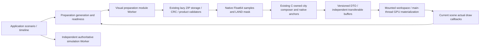

# City Preparation V1 boundary

Status: current owner-review candidate; validation is recorded separately.

The coordinator is presentation state, not game authority. It has no simulation
commands, ticks, saves, networking authority or new source-data schema. It binds
scenario/timeline/retry identity and current source/policy signatures. Old effect
results and old Canvas/batch callbacks cannot acknowledge the active scope.

The existing public ZIP cache has one implementation in
`apps/web/src/assets/public-layer-loader.ts`; `public-layers.ts` remains its public
browser facade. Catalog versions, paths, CRC, existing product integrity checks,
valid absent cities and required infrastructure errors retain their original meaning.
Archive ownership is disjoint. The small scenarios and population-fields ZIPs
remain with the host session-input loader so selecting/restoring a scenario
cannot queue behind synchronous visual composition. The other eight layers use
the visual worker. Each physical ZIP has exactly one acquisition/inflation owner;
there is no second storage implementation. Scenario/population JSON parsing
therefore remains main-thread work, explicitly outside the offloaded geographic
pipeline.
C remains building authority at every camera band. A/B outline demand remains
separate and disabled by default.

Protocol V1 supports asset, native terrain, selected cells/roads and C composition
requests. It validates version/correlation, city/level/hash envelopes, native buffer
dimensions and composition/anchor identity. A single worker owns geographic decompression and
core preparation; session-input ownership is described above. No ZIP is fetched
or inflated by both owners and the simulation Worker is not reused.
The worker holds its native arrays and cached anchors. Each outgoing native packet
owns independent buffers, and each anchor response copies its compact Float64 array
before transfer. Main and mini consumers share successful promises; they never
transfer ownership of the same retained buffer twice.

A code-only Worker handshake starts alongside host scenario/population acquisition.
It requests no archives or city products, shares the same client with later jobs,
and never allocates the legacy fallback engine merely to warm code.

The checked-in policy is `apps/web/src/city-preparation/city-preparation-settings.ts`.
Defaults: one visual Worker, eight outstanding jobs, one recent city plus the
current city, 64 MiB estimated retained DTO payload / 16 entries, 128 MiB binary
packet cap and a 60-second runtime job deadline. These are distinct from unchanged
render, source ZIP and city proposal budgets. Worker failure closes/rejects pending
requests; failed promises are evicted and retry acquires a fresh channel if needed.
Workers unavailable/denied use an explicitly diagnosed legacy path that yields
between jobs. Its individual synchronous composer is not preemptible; do not call
that path off-thread or fully cooperative within a composition.

Strict Mode effect replay reactivates the same suspended coordinator snapshot,
including a pending or error state; real unmount still cancels immediately.
Delayed failed plans only evict their own current cache entry, never a newer
same-key request after a scenario round trip.
The overlay does not replace or key/remount the game shell. It shows the selected
city and real monotonic phase text. The initially visible D3D mini view may qualify
only through its actual draws; an inactive/unmounted view cannot. Native/fallback
and current city/roads must acknowledge the active presentation. Optional details
never reopen or delay initial readiness. Remaining terrain/road/cover/site/landscape
numeric planning and all Three/WebGL objects stay main-thread-owned.

`cypress/support/city-preparation.ts` reads this production state. It separately
waits for input/preparation and actual presentation using established per-stage
bounds. Camera/road LOD acknowledgements remain separate requirements. Simulation
movement tests must still establish authoritative advancement and real movement;
preparation readiness cannot stand in for either condition.

Owner editing guide:

- Keep preparation enabled for genuine off-thread C composition.
- Keep queue, payload and runtime limits conservative; they are not render budgets.
- More than one visual Worker requires a reviewed ownership/scheduling implementation;
  raising a policy ceiling does not create another archive owner.

No new persistent cache, dependency, source archive, city-generation rule, DEM,
coastline, simulation, transport or save/protocol change is part of this boundary.
